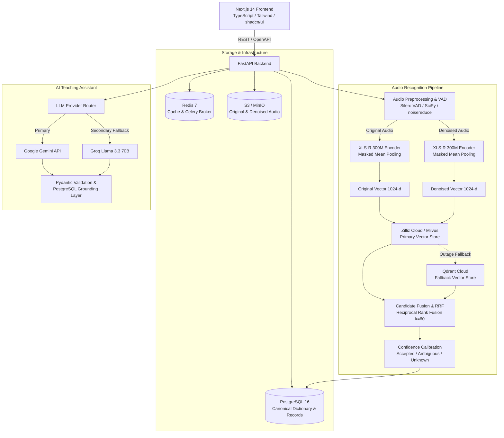

# PRODUCTION ARCHITECTURE SPECIFICATION
## Badaga & Marwari Voice-Based Vocabulary Learning Platform

### 1. Architectural Boundaries & Division of Responsibility
1. **PostgreSQL 16**: Authoritative canonical source of truth for all vocabulary records, English/Tamil translations, user accounts, lessons, quizzes, practice history, and vector replication audit logs.
2. **XLS-R 300M (`facebook/wav2vec2-xls-r-300m`)**: Frame-level acoustic encoder producing 1024-dimensional speech embeddings with attention-masked mean pooling.
3. **Zilliz Cloud (PyMilvus)**: Primary vector similarity search across versioned collections (`badaga_original_v1`, `badaga_denoised_v1`, `marwari_original_v1`, `marwari_denoised_v1`).
4. **Qdrant Cloud (`qdrant-client`)**: Dedicated fallback vector database when Zilliz Cloud experiences outages.
5. **Google Gemini API & Groq API**: Generative tutoring, explanation, and quiz generation strictly grounded in approved PostgreSQL records.
6. **Object Storage (S3 / MinIO)**: Storage of pristine original recordings and denoised derivatives.
7. **Next.js Web Client**: Accessible, responsive student, teacher, and administrator portal with audio recording and verified pronunciation playback.
